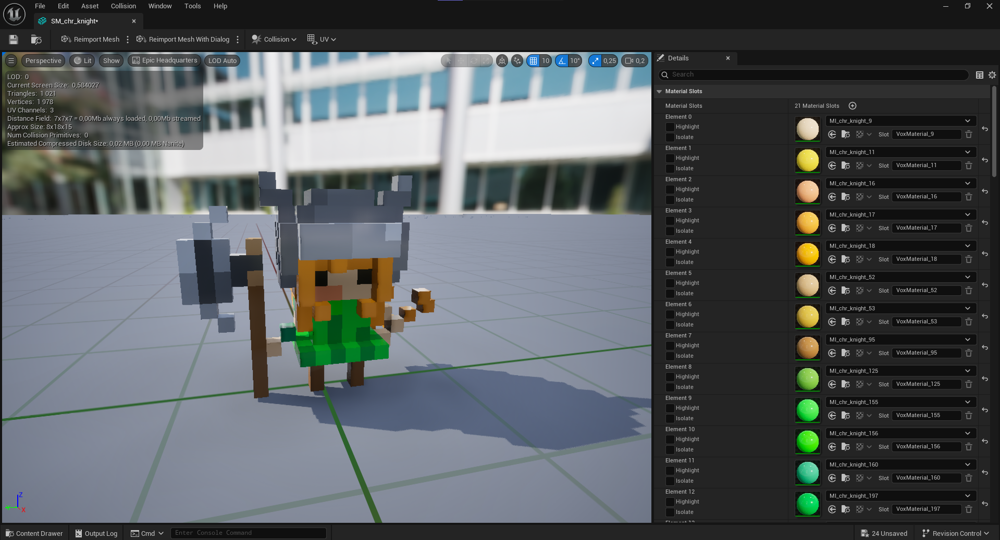
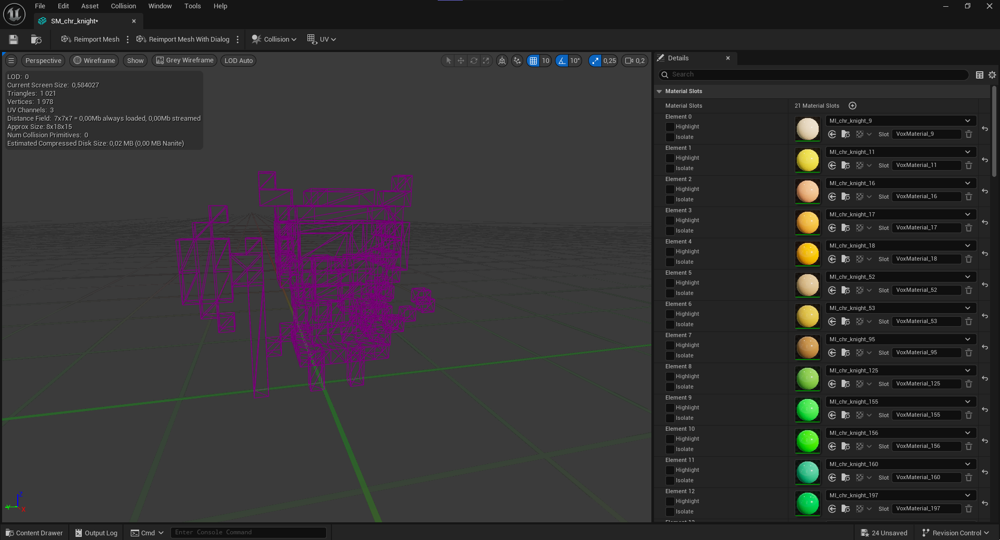
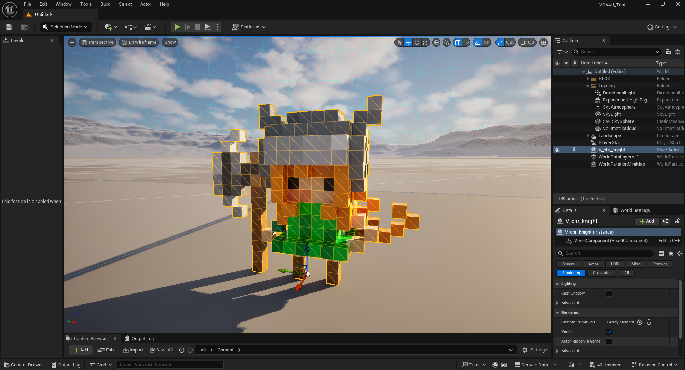
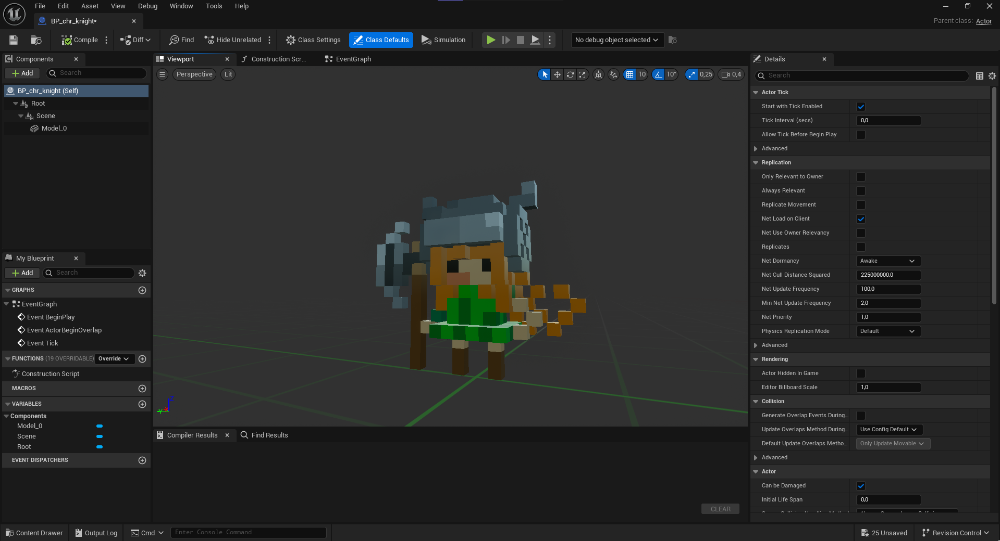
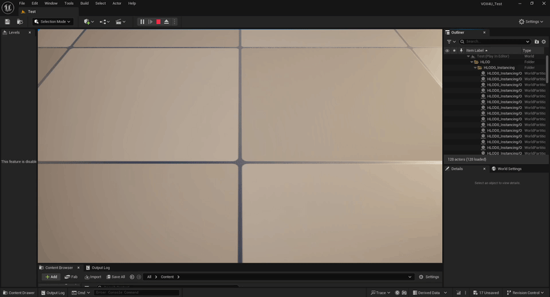
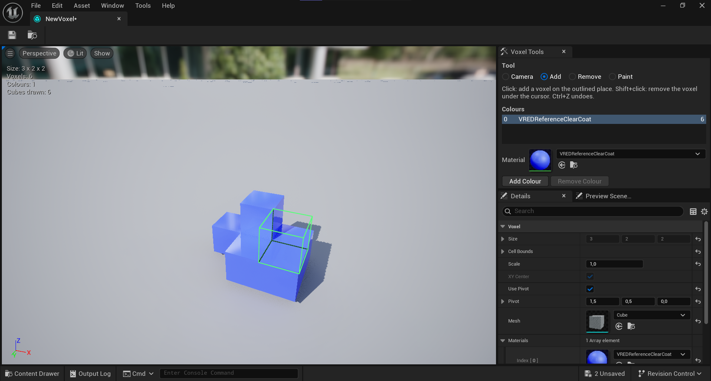

# VOX4U
Import [MagicaVoxel](https://ephtracy.github.io/index.html?page=mv_main) `.vox` files into [Unreal Engine 5](https://www.unrealengine.com/).

Original Creator Repositorium: [VOX4U Original](https://github.com/mik14a/VOX4U)

Files are read by [vox4c](https://github.com/Muppetsg2/vox4c), a single-header C loader (vendored in
`Source/Thirdparty/vox4c`), so every MagicaVoxel version is supported: files older than 0.98, legacy `MATT`
materials, the 0.99.x material keys and the current 0.99.7 format.

## Unreal Engine versions

Unreal Engine **5.0 and newer**. The code is written for the newest engine; only where an API does not exist in an
older version, the old way is used behind a version check. All checks use one macro from
`Source/VOX4U/Public/VOX4UVersion.h`:

```cpp
#if VOX4U_UE_AT_LEAST(5, 1)
	// current API
#else
	// UE 5.0
#endif
```

| Where | 5.1 and newer | 5.0 |
|---|---|---|
| voxel thumbnails (`VoxelThumbnailRenderer.cpp`) | `UThumbnailRenderer::RenderViewFamily(Canvas, Family, View)` | `CreateView` + `BeginRenderingViewFamily` with a legacy screen percentage driver |
| `*.Build.cs` (`#if UE_5_1_OR_LATER`) | `IncludeOrderVersion = EngineIncludeOrderVersion.Latest` | engine default |

Everything else (`FMeshDescription`, `UMaterialEditingLibrary`, `TObjectPtr`, `UDeveloperSettings`, ...) is the current
API and exists unchanged since 5.0. The voxel asset type is registered with `FAssetTypeActions_Base`, which newer
engines (5.2+) still accept and wrap in an asset definition: its replacement, `UAssetDefinition`, is a `UCLASS`, and
Unreal's header tool does not allow a `UCLASS` inside an engine version check, so it cannot be used without dropping
5.0 and 5.1.

Precompiled binaries are tied to one engine version; for any other version compile the plugin from source (see
Installation).

## Description

Import voxel objects as a **Static Mesh**, a **Voxel** asset or a whole **Scene** — no other content creation tool is
needed. Every import can be scaled, renamed and placed with a pivot of your choice.

### Static Mesh



- **Separate models** — one static mesh per model of the file.
- **Merged** — every model in one static mesh, **placed as in the MagicaVoxel scene** (node transforms, rotations,
  mirroring, groups), baked by vox4c. Hidden nodes and layers are skipped unless *Import Hidden* is on; animated files
  are placed at the selected *Frame*, or every frame becomes a mesh (see Animation).

Meshes are generated with [monotone meshing](https://0fps.net/2012/07/07/meshing-minecraft-part-2/), with one
material slot per used colour and:

- UV0: the palette texel of the colour,
- UV1: planar voxel UVs (1 unit = 1 voxel), source of the generated lightmap UVs in UV2,
- vertex colours: the palette colour,
- flat normals, welded positions, hard edges.



### Voxel



A voxel asset rendered with instanced static meshes: one cube mesh (`SM_<Name>_Cube`, with box collision) shared by
all voxel assets of the import, and one material instance per used colour (*Materials* of the asset). All cubes of a
colour are drawn together, in one draw call per render pass. Merged voxel assets also follow the scene transforms. The *Pivot* option is stored in the asset (*Use Pivot*, *Pivot* in voxels
from the grid corner), so the voxel component is placed the same way as a static mesh of the same model.

Double clicking a voxel asset opens the **Voxel Editor**, where its voxels and colours can be edited (see
[Voxel Editor](#voxel-editor)). New, empty voxel assets are made in the Content Browser: **Add > Miscellaneous >
Voxel**.

If runtime access to the Voxel Actor is not required, the runtime module can be removed from the `.uplugin` file,
allowing packaging without the runtime module.

### Scene (Blueprint)



An actor Blueprint that rebuilds the MagicaVoxel scene graph: one component per node with its name and transform
(groups become scene components), one shared model asset per model (instanced models reuse it), and optionally

- the **sun** as a directional light (direction, colour, intensity × *Light Intensity Scale*, soft shadows from the
  sun size),
- every **camera slot** a view was saved into as a camera component (position, orientation, field of view,
  orthographic / isometric slots as orthographic cameras).

*Scene Models* chooses what the nodes show:

| Scene Models | Components | Description |
|---|---|---|
| **Static Meshes** (default) | Static Mesh components, `SM_<Name>_<model>` | optimized meshes, few triangles, the fastest to render |
| **Voxel Assets** | Voxel components, `V_<Name>_<model>` | every voxel stays a separate cube (instanced), e.g. to find single voxels at runtime (`GetVoxelTransform`); heavier to render, and switching models in a frame-by-frame animation rebuilds the instances |

Importing the scene again rebuilds the Blueprint's components; its graphs and variables are kept.

## Animation



MagicaVoxel animates nodes in two ways: their transform (keyframes on groups and models) and the model they show
(frame-by-frame animation, e.g. a walk cycle made of several models). Both are imported from animated files when
*Import Animation* is on. The animation covers the range of MagicaVoxel's timeline (frames 0–30 unless the file says
otherwise); identical frames are detected and share their mesh.

| Import Type | Result |
|---|---|
| **Scene (Blueprint)** | a **Voxel Animation** asset (`VA_<Name>`) with a track per animated node, and a **Voxel Animation** component in the Blueprint that plays it on the node components (static mesh or voxel components, see *Scene Models*) |
| **Static Mesh, merged** | one static mesh per distinct frame (`SM_<Name>_F<frame>`, all with the same origin) and a Voxel Animation asset that switches between them |

*Sampling* (Scene): **MagicaVoxel** holds every frame and keeps translations on the voxel grid, exactly as MagicaVoxel
plays the animation; **Smooth** interpolates translations and rotations between keys and, while playing, between
frames (vox4c's smooth sampling, baked per frame and interpolated with the same result). Mirroring and model changes
always switch at whole frames.

The **Voxel Animation component** (`UVoxelAnimationComponent`, Animation category of *Add Component*):

| Property / Function | Description |
|---|---|
| Animation | the Voxel Animation asset |
| Auto Play, Loop, Play Rate | playback; a negative play rate plays backwards |
| Frame | current frame; changing it in the editor previews the frame, it can be keyed in **Sequencer** |
| Play, Stop | Blueprint API, and buttons in the details panel that preview the animation in the editor |
| IsPlaying, SetFrame, SetAnimation, OnFinished | Blueprint API |

Tracks find their component by name; a track without a name drives the root component (or the first static mesh or
voxel component). A track switches static meshes on a static mesh component and voxel assets on a voxel component
(*Models* of the Voxel Animation asset). To play the frames of a merged static mesh, place any frame mesh in the level, add a Voxel Animation
component and select the `VA_` asset. Animated components are made movable.

### Preview in the editor

Select the actor in the level, or open the Blueprint, select the **VoxelAnimation** component and press **Play** in
the *Voxel Animation* category of the details panel: the animation plays in the level viewport or in the Blueprint
editor's viewport, looping, without starting the game (the viewport has to be *Realtime*, the default). **Stop** ends
the preview and returns to the frame it started from. *Frame* (drag the value) shows any
single frame, and the component can be animated in **Sequencer** by keying *Frame*. Moving the actor reruns its
construction script, which ends the preview.

MagicaVoxel does not store the playback speed in the file: it is set by *Frames Per Second* (import option, and
property of the Voxel Animation asset, default 10).

## Voxel Editor



Double clicking a voxel asset (imported, or new from **Add > Miscellaneous > Voxel**) opens the Voxel Editor, laid
out like the Static Mesh Editor:

| Tab | Description |
|---|---|
| **Viewport** | orbit camera, the usual viewport toolbar (view modes, show flags), **F** frames the voxels; size, voxel count, colours and drawn cubes in the corner |
| **Voxel Tools** | the tool of the left mouse button and the colours of the asset |
| **Details** | the asset's properties: pivot, cube meshes, materials, voxels |
| **Preview Scene Settings** | floor, sky and lights of the preview |

Tools (the cell that a click changes is outlined in the viewport):

| Tool | Click | Shift + click |
|---|---|---|
| **Camera** | moves the camera only | |
| **Add** (green) | adds a voxel of the selected colour on the face under the cursor, or on the floor of the grid | removes the voxel |
| **Remove** (red) | removes the voxel | |
| **Paint** (yellow) | gives the voxel the selected colour | selects the colour of the voxel |

Dragging with the mouse moves the camera as in the Static Mesh Editor; every edit can be undone with **Ctrl+Z**.

**Scale** of a voxel asset is the size of one voxel in Unreal units (cm), as the *Scale* import option: the cube
meshes are scaled to it, so it can be changed after the import (a reimport keeps it). New assets use 1 cm voxels,
like imports with the default *Scale* of 1.0.

A colour is a material (*Materials* of the asset; *None* uses the material of the cube *Mesh*).
In **Voxel Tools**: select a colour in the list (the number of its voxels is shown next to it), pick its
**Material**, **Add Colour** (a copy of the selected colour, up to 256) or **Remove Colour** (removes its voxels too;
the last colour stays). All colours are drawn with the asset's cube *Mesh*.

Voxel assets imported before 0.6.0 have one cube per colour (the colour is in the cube). They keep working, with these
cubes as *Legacy Meshes*; reimporting such an asset turns it into one cube and material instances, and the old cubes
(`SM_<Name>_<model>_<palette>`) can then be deleted.

Edits keep the voxels in place: an asset that used *XY Center* switches to the same *Pivot*, and voxels added below
or behind the grid move the grid corner together with the pivot. Every actor, Blueprint and scene that shows the asset
is updated right away. Reimporting the `.vox` file of an imported asset replaces the edits (the Voxel Tools tab warns
about it).

## Materials

| Mode | Result |
|---|---|
| **Multi-material** (default) | a parent material `M_<Name>` and one material instance per used colour, `MI_<Name>_<palette index>` |
| **Multi-material + Palette To Texture** | the same, the colour comes from the palette texture instead of a `Color` parameter |
| **One Material** | one opaque material: colour from `T_<Name>_Palette`, roughness / metallic / specular / emission from `T_<Name>_Properties` |

*One Material* and *Palette To Texture* are for static meshes: they tell the colours apart by the UVs of the mesh.
Voxel assets (also in a scene with *Voxel Assets*) always get one material instance per colour with a `Color`
parameter, and the import dialog hides both options for them.

Both lookup textures are 1 pixel high (one texel per used colour), uncompressed and point sampled, so colours never
bleed into each other.

MagicaVoxel material → Unreal:

| MagicaVoxel | Unreal |
|---|---|
| `_rough` | Roughness |
| `_metal` (metal, blend) | Metallic |
| `_sp` (metal, blend; 0..2, default 1) | Specular × 0.5 (0..1, default 0.5) |
| `_emit`, `_flux` (emit) | Emissive = colour × `_emit` × (1 + `_flux`) × `EmissionScale` (parameter of the parent material, default 4) |
| `_trans` (glass, blend) | translucent instance, Opacity = 1 − transparency, Refraction = `_ri` |
| media (`_d`) | translucent instance, Opacity from the density (approximation) |

Reimports update textures and material instances in place. An existing parent material is kept as it is (it may have
been edited); delete it to have it generated again.

## Import options

| Option | Description |
|---|---|
| Import Type | Static Mesh, Voxel or Scene (Blueprint) |
| Naming Convention, Custom Asset Name | asset names (patterns in **Project Settings > Plugins > VOX4U**) |
| Resources Save Location | materials / textures / voxel cubes next to the asset or in `<Name>_Resources` |
| Import X Forward | turn the model's front (MagicaVoxel −Y) towards +X |
| Pivot | MagicaVoxel, Corner, Center or Bottom Center (merged: the scene origin for MagicaVoxel) |
| Separate Models | one asset per model, or all models merged as in the scene |
| Import Hidden | include nodes hidden in MagicaVoxel (node, group or layer) |
| Frame | animation frame used to place merged models and scene nodes |
| Scale | size of one voxel in Unreal units (cm) |
| Generate Lightmap UVs | lightmap UVs from the planar voxel UVs |
| Scene Models | Scene only: static meshes or voxel assets, see Scene (Blueprint) |
| Import Animation, Sampling, Frames Per Second | animated files, see Animation |
| Import Sun, Import Cameras, Light Intensity Scale | Scene only |

The options are saved per project. Automated imports (commandlets, `-unattended`, `AssetImportTask.automated`) do
not show the dialog.

### Asset names

The name patterns of both conventions are edited in **Project Settings > Plugins > VOX4U** and saved in the
project's `Config/DefaultEditor.ini`. Tokens: `{BaseName}`, `{ModelId}`, `{Color}`, `{Description}`. An underscore
inside the braces is only written when the token has a value: `SM_{BaseName}{_ModelId}` gives `SM_Tree` for merged
models and `SM_Tree_2` for the third model.

*Custom Asset Name* replaces the file name in `{BaseName}`. When several files are imported at once, a number is
added so that they do not overwrite each other: after **Import All** every file gets the next number (`Tree_1`,
`Tree_2`, ...); after **Import** (the dialog is shown for every file) a name that was already used in this import gets
a number from the second file on (`Tree`, `Tree_2`, ...).

### Importing from Python

```python
import unreal

options = unreal.VoxImportOption()
options.set_editor_property("vox_import_type", unreal.VoxImportType.SCENE)
options.set_editor_property("scale", 10.0)

task = unreal.AssetImportTask()
task.set_editor_property("filename", "C:/Voxels/castle.vox")
task.set_editor_property("destination_path", "/Game/Voxels")
task.set_editor_property("automated", True)   # no dialog
task.set_editor_property("save", True)
task.set_editor_property("options", options)  # without options the saved ones are used

unreal.AssetToolsHelpers.get_asset_tools().import_asset_tasks([task])
```

## Translations

The interface of the plugin (import dialog, options, tooltips, messages, project settings) follows the editor
language (Editor Preferences > Region & Language). Translations are plain `.po` files in the `Localization` folder
of the plugin:

```
Plugins/VOX4U/Localization/
    VOX4U.pot   every English text (template)
    pl.po       Polish
```

To add a language, copy `VOX4U.pot` to `<culture>.po` (`es.po`, `de.po`, `fr.po`, `pt-BR.po`, ...) in the same
folder, fill in the `msgstr` lines (by hand or with an editor such as Poedit) and restart the editor or switch its
language. Nothing has to be compiled. A regional language falls back to its parent (`pt-BR` → `pt`); missing
translations stay in English.

After changing texts in the code, run `python Tools/UpdateLocalization.py`: it rebuilds `VOX4U.pot`, adds new texts
to every `.po` file and marks translations whose English text changed as *fuzzy* (they are not used until reviewed).
`--check` only reports, for CI. The keys are the ones Unreal uses itself, so the files also work with the
Localization Dashboard.

Names of Blueprint functions (`AddVoxel`, ...) are not translated.

Step by step guide for translators (Poedit, file names, updating): [Localization/README.md](Localization/README.md).

## VOX format

Supported: every version of the format (header version 150 and 200), read by vox4c.

| Chunk | Description |
|---|---|
| `SIZE`, `XYZI`, `RGBA`, `PACK` | models and palette |
| `MATL`, `MATT` | materials, older versions converted the way MagicaVoxel 0.99.7 converts them |
| `nTRN`, `nGRP`, `nSHP` | scene graph, transforms, instancing, animation keyframes (`_f`, `_loop`) |
| `META` | animation range of the timeline |
| `LAYR` | hidden layers |
| `rOBJ` | the sun (Scene import) |
| `rCAM` | camera slots (Scene import) |

## Usage

Drag & Drop `.vox` file to content panel or open import dialog and select **MagicaVoxel(*.vox)** files.
During import you can choose the import type, rename the asset, separate or merge the models and adjust the scale,
pivot and material options.

Static meshes (including the frames of an animation) and voxel assets can be reimported (right click → *Reimport*);
they are rebuilt in place with the options they were imported with. A scene Blueprint and its animation are updated
by importing the file again into the same folder.

## Installation

Clone the plugin into your Unreal project:
```sh
cd {YourUnrealProject}
git clone https://github.com/Muppetsg2/VOX4U.git ./Plugins/VOX4U
```

Or add it as a submodule:

```sh
cd {YourUnrealProject}
git submodule add https://github.com/Muppetsg2/VOX4U.git ./Plugins/VOX4U
```

Open the project and let the editor compile the plugin, or build it for a specific engine version with:

```sh
{UE}/Engine/Build/BatchFiles/RunUAT.bat BuildPlugin -Plugin={Path}/VOX4U/VOX4U.uplugin -Package={OutputDir}
```

Alternatively, you can download the precompiled binary from the plugin [release page](https://github.com/Muppetsg2/VOX4U/releases/latest) and copy it directly into the same `Plugins/VOX4U` folder (only for the engine version it was built for).

If you are creating a package without C++ access, copy the plugin to the `Engine/Plugins/Runtime` directory.

## Source layout

| Directory | Description |
|---|---|
| `Source/VOX4U` | runtime module: `UVoxel` asset, `UVoxelComponent`, `AVoxelActor`, `UVoxelAnimation`, `UVoxelAnimationComponent` |
| `Source/VOX4UEditor` | editor module: factory (`UVoxelFactory`), `FVoxImporter`, `VoxMeshBuilder`, `FVoxMaterialBuilder`, voxel editor (`FVoxelEditorToolkit`, `SVoxelEditorViewport`, `SVoxelEditTools`, `VoxelEditing`, `UVoxelFactoryNew`), naming, localization |
| `Source/Thirdparty/vox4c` | vox4c as an external, header only module; its implementation is compiled once in `Vox4cImplementation.cpp` |
| `Localization` | translations |
| `Tools/UpdateLocalization.py` | collects the texts for translators |

## Debugging

If you experience build issues with the plugin, use the [UnrealEnginePluginMigrationTool](https://github.com/mickexd/UnrealEnginePluginMigrationTool) to rebuild it and review the console output for detailed error messages.

## License

[MIT License](https://github.com/Muppetsg2/VOX4U/blob/master/LICENSE). vox4c is MIT licensed as well (see the end of
`Source/Thirdparty/vox4c/vox4c.h`).
